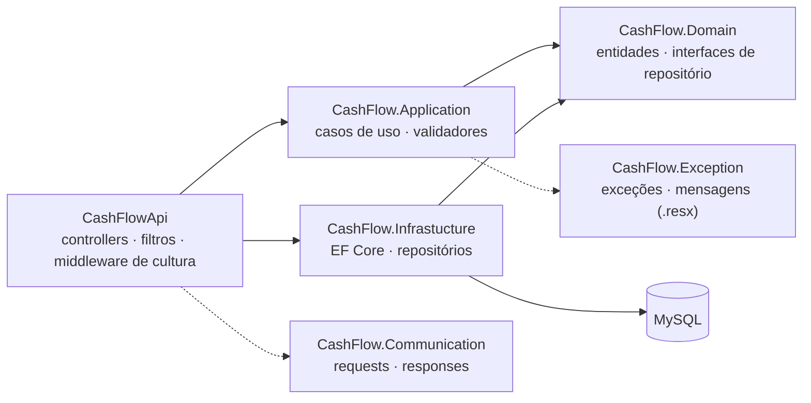

<div align="center">

# 💰 CashFlow

**API em .NET 8 para controle de despesas pessoais, construída em camadas (DDD) com validação e mensagens de erro multi-idioma.**


</div>

---

## 💡 Sobre

O CashFlow é uma API REST para registrar e organizar despesas. O foco do projeto é a arquitetura: a solução é dividida em projetos independentes (API, Application, Domain, Infrastructure, Communication e Exception), com casos de uso isolados, validação com FluentValidation e mensagens de erro traduzidas conforme o header `Accept-Language`. Projeto de estudo desenvolvido durante a formação C# da Rocketseat — atualmente com o caso de uso de cadastro de despesas.

## ✨ Funcionalidades

- 🧾 Cadastro de despesas (título, descrição, data, valor e forma de pagamento)
- ✅ Validações: título obrigatório, valor maior que zero, data não futura e forma de pagamento válida
- 🌍 Mensagens de erro em inglês, português (pt-BR e pt-PT) e francês via `Accept-Language`
- 🧱 Filtro global de exceções com resposta padronizada (`ResponseErrorJson`)
- 🧪 Testes unitários do validador com xUnit, FluentAssertions e Bogus

## 🛠️ Tecnologias

.NET 8 · ASP.NET Core Web API · Entity Framework Core 8 · Pomelo (MySQL) · FluentValidation · Swagger (Swashbuckle) · xUnit · FluentAssertions · Bogus

## 🏗️ Arquitetura



## 📌 Endpoints

| Método | Rota | Descrição |
|---|---|---|
| `POST` | `/api/expenses` | Registra uma nova despesa |

<details>
<summary>Exemplo de requisição</summary>

```json
{
  "title": "Mercado",
  "description": "Compras do mês",
  "date": "2025-01-20T10:00:00",
  "amount": 350.90,
  "paymentType": 1
}
```

`paymentType`: `0` Dinheiro · `1` Cartão de crédito · `2` Cartão de débito · `3` Transferência eletrônica.
Erros de validação retornam `400` com a lista de mensagens no idioma solicitado.

</details>

## 🗄️ Banco de dados

MySQL 8 via EF Core (Pomelo), com a entidade **Expense**: `Id`, `Title`, `Description`, `Date`, `Amount` e `PaymentType`. O projeto ainda não possui migrations — a tabela `Expenses` precisa existir no banco `cashflowdb`.

## 🚀 Como rodar

Pré-requisitos: [.NET 8 SDK](https://dotnet.microsoft.com/download/dotnet/8.0) e um MySQL 8 local.

1. Ajuste a connection string `ConnectionStrings:Connection` em `src/CashFlowApi/appsettings.json` (ou defina a variável de ambiente `ConnectionStrings__Connection`) com o seu servidor, banco, usuário e senha.
2. Rode a API:

```bash
dotnet restore
dotnet run --project src/CashFlowApi
```

A API sobe em `http://localhost:5195` (perfil `http`), com Swagger em `/swagger` no ambiente de desenvolvimento.

## 🧪 Testes

```bash
dotnet test
```

## 📄 Licença

Distribuído sob a licença MIT. Veja [`LICENSE`](LICENSE).

## 👤 Autor

Feito por [Kevin Lopes](https://github.com/KevinLopes23)
